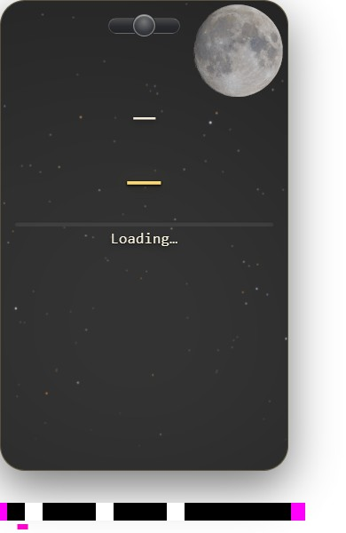
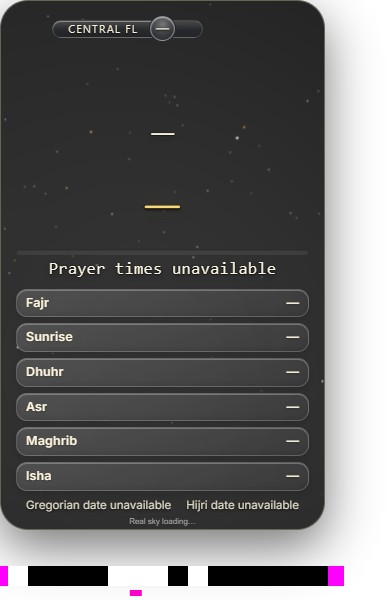
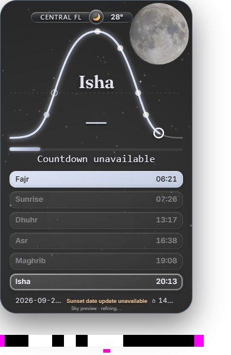

# Retained native negative: scoped TA1 acceptance

The [independent review](../reviews/ta1-negative-r116-review-r1.json) accepts the historical r19 missing-Moon recording as TA1's equivalent native negative for the unchanged clear-night Moon detector. This discharges that sensitivity check without another browser run. It does not qualify current S1.

Originals11–23 show the warranted Moon absent while the card and catalogue remain. Their source timestamps span148.298ms, with a maximum internal interval34.898ms. All13 decoded full images differ and the exterior CSS marker advances; no duplicate frames were inserted. Present-before originals9/10 and present-after24 supply positive controls. The application rAF marker holds737; it is not used as a progressing clock.

The [result](RESULT.json), [original sidecar](original-source-frames.jsonl), [16 selected originals](originals/), original [observation](historical/MOON-GAP-OBSERVATION-r22.json), and [source control](source-control/MOON-STAGED-CONTROL.json) are preserved. The source control reproduces the old staged-preview prerequisite failure and checks the corrected owner with current/stale negatives. It does not establish a unique cause for every recorded interval.

| Present before | Absent | Present after |
|---|---|---|
|  |  |  |

Every acquisition interval remains unobserved between source outputs. The148.298ms span is detector sensitivity to actual captured missing content, not uninterrupted physical-display certification. Preceding192.420ms and following243.679ms gaps remain **UNOBSERVED**. Historical trace-enabled r11 is not an ordinary current-candidate timing case. The fixed390×600 clear-night ROI does not detect every lunar/solar defect; r117 demonstrates why whole-frame review still governs.

The unmodified r52 detector and r116 derivation are in `historical/`; the retained source reproducer and association review are in `source-control/`. The complete original r19 sidecar and annotations are published, but only the16 relevant JPEGs and one additional original filmstrip image are included here. No claim is made that the unrelated historical trace or all r19 frames were republished. Original/private versus projected/public hashes are explicit in [PUBLICATION.json](../PUBLICATION.json).
