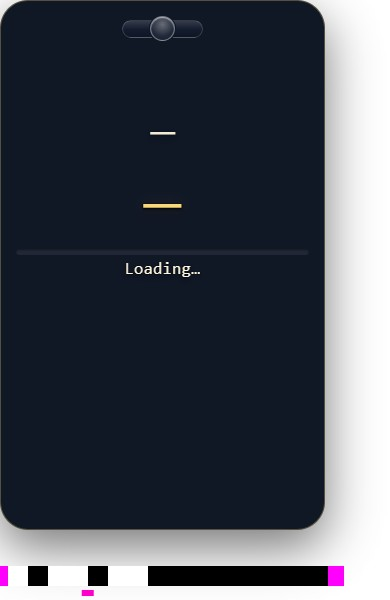
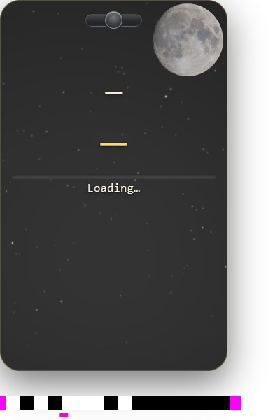
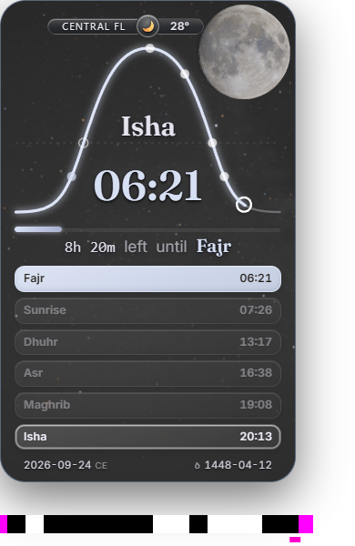
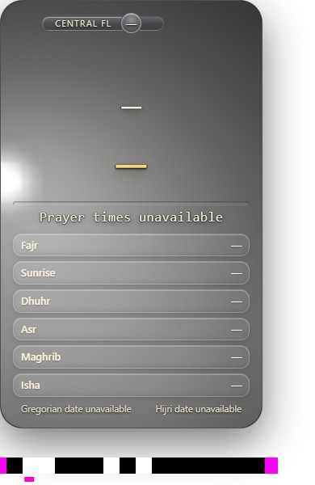
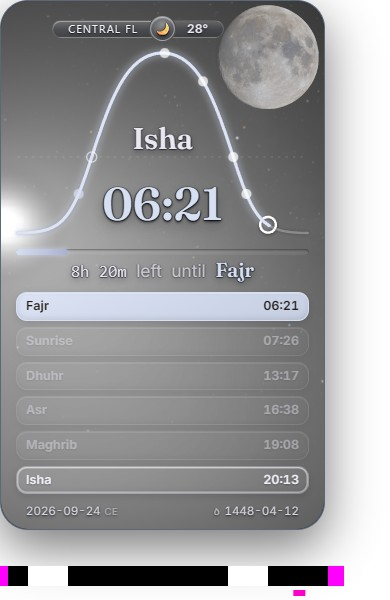

# One Chromium baseline/current first-boundary comparison

This is one independently admitted, serial, isolated Chromium148.0.7778.96 cold/direct DPR1 pair. It uses the unchanged r105 harness and capture driver, ordinary1x fixed-date clear-night Orlando fixture, disposable persistent profiles and production RenderDocument defaults. No CPU profiler, trace or Firefox acquisition was used. `--duration20` is a ceiling after the first15s, not a guaranteed20s watch. Both runs returned normally, all runtime/harness pins remained exact, and the owned lease/browser resources were released.

Candidate source is `fd309d10598a89ce3700550a71abc6bac25e9052`, runtime `70bb508176c976167d783a5c7c7bd09ab20d02f69669dce5d36af5c634b1c55e` (142files). Baseline is original committed `18ff14860ff41c084b1db5f396bb62aa9c22b1be`, runtime `f443cf0820e6879dfa7c3ce857d6b2baf554b1fdd2f889433d22e2c532cec260` (135files), not production integration base `f270792f39ef8bf4cabffbe6746ac0ea0dd9d3de`.

## Supported observation, retained limits

Independent [final review r2](../reviews/first-boundary-r117-result-review-r2.json) inspected all candidate originals1–14, first celestial15, intermediate438, final PNG, and the contrary baseline originals. The candidate co-captures a textured apparently opaque Moon and catalogue after the neutral Loading card. Navigation-to-complete receipt upper bound is **399.749756ms**; original accepted-scene-to-complete is **158.699951ms**, using the original head capture, not a later poll. These meet1000/250ms for this observed case. The sampled neutral14→complete15 source interval is **11.721849ms**.

| Candidate neutral14 | Candidate complete15 | Candidate final |
|---|---|---|
|  |  |  |

At15032.7ms page clock the candidate is Moon ready/current/refined-terrain, projected empirical change0.0821685791015625≤0.5, four remaining receiver heuristics, sky ready, errors empty, six rows and footer intact. The intermediate and final inspected images show no scene loss or objectionable swap. This is not human review of every1453 frame or exact visual timing of the preview/refined publication.

**Whole S1 and matched added latency remain INCOMPLETE.** The first approximately272.455ms of candidate source coverage is absent; no first-ever exposure during that blind interval is claimed. Later115.920/172.367/150.046ms acquisition gaps remain **UNOBSERVED**. The sampled11.722ms boundary does not prove uninterrupted hardware presentation or fill those gaps.

The baseline's first observed celestial frame11 has a bright Sun-like wash in this night fixture and no Moon. Frame551 gains Moon/catalogue but retains the wrong wash. Thus the fixed ROI detector's positive at551 is **not a coherent expected-night counterpart**. The unchanged raw [SUMMARY.json](SUMMARY.json) retains its proposed source-clock-dependent comparison; independent review rejects that5.7s coherent-scene speedup inference. The alternative−9.828ms observed first-any-celestial comparison also lacks a first-ever baseline lower bound because its first264.028ms is unobserved. Baseline `firstInitial`, `firstPaint` and earliest-accepted origin remain null. Its final refining state at20505.6ms is neither a demonstrated deadline failure nor a performance result.

| Baseline first observed celestial11 | Baseline ROI-positive551 |
|---|---|
|  |  |

This is contrary baseline evidence, not a new candidate defect. There is no authorised automatic repeat or new recorder work arising from this result. The final review r2 supersedes [r1](../reviews/first-boundary-r117-result-review-r1.json) only to round one narrative blind-span value consistently; both are retained.

## Reproduction and custody

[EXECUTION.json](EXECUTION.json), both `results.json` files, original videos/sidecars, all2007 baseline and1453 candidate JPEGs in numbered ZIPs, final PNGs, selected direct originals, the unchanged detector's candidate annotations and the offline summary are published. The ZIPs contain ascending800-frame chunks (baseline three, candidate two); SUMMARY supplies every original frame hash. No duplicate padding or interpolation is counted. [PUBLICATION.json](../PUBLICATION.json) binds original and projected bytes. Only declared host-path roles and JSON serialization differ in textual projections.

For offline review, unpack the JPEG ZIPs, join each original sidecar row by filename and hash to SUMMARY, inspect whole originals, and apply the unchanged clear-night thresholds in [r52](../r116/historical/annotate_direct_source_r52.py). The complete derivation is [preserved](historical/summarise_first_boundary_r117.py); its numerical comparison requires the independent adjudication above, not automatic acceptance.

For an independently authorised native reproduction, serve the committed baseline runtime and the exact current runtime separately. Use `tools/cp9/celestial_startup_check.py`, `tools/cp9/prepare_capture_driver.py` and the seven pinned source inputs in EXECUTION, with the recorded isolated browser/driver versions. The exact command/options are recorded; `${REPO_ROOT}`, `${WORK_ROOT}`, `${PLAYWRIGHT_PYTHON}` and executable tokens are relocatable roles. No new toolchain or measurement method is required. The historical wrapper is evidence of this completed pair, not permission to repeat it or an instruction to modify personal browser settings.
