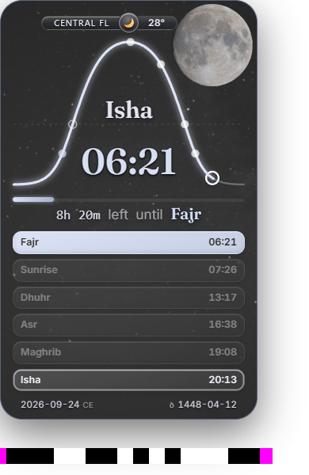
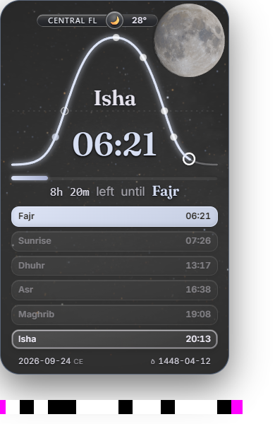
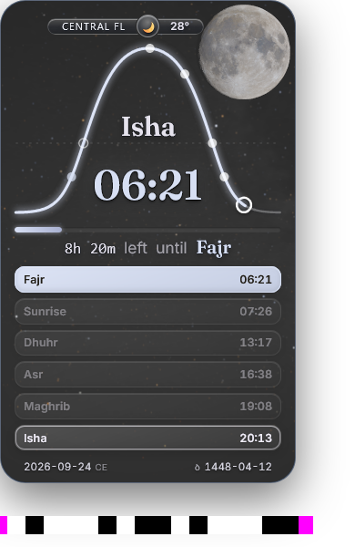
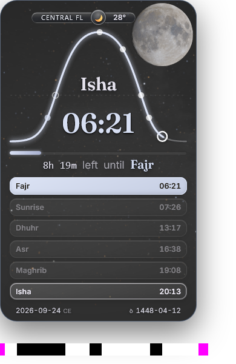

# Actual interrupted-body recovery in Chromium and Firefox

The [independent native review](../reviews/body-interruption-r118-result-review-r1.json) accepts this narrow S5/S6 recovery chain on unchanged runtime `70bb508176c976167d783a5c7c7bd09ab20d02f69669dce5d36af5c634b1c55e`: **actual interrupted astronomical response body → truthful unavailable status with current initial Moon retained → explicit retry → current admitted final refinement**. No product change or repeat was needed.

The isolated test server sent HTTP200 and the correct20,137,935-byte Content-Length for the actual DEM, flushed4096 original bytes, then closed that connection. The original worker fetch/body consumer handled the failure. The server restored the complete original asset before the existing harness invoked both Moon and sky-assets retry. This is distinct from a503 response or invalid worker dimensions.

| Observation | Chromium148.0.7778.96 | Firefox150.0.2 |
|---|---|---|
| Native failure | `network error` | `Moon asset truncated` |
| At15s | unavailable; current `initial-v5`; worker stopped | unavailable; current `initial-v5`; worker stopped |
| Explicit Moon retry | accepted, count1 | accepted, count1 |
| Final | ready/current `refined-terrain`, no rejected result | ready/current `refined-terrain`, no rejected result |
| Empirical projected change / unchanged gate |0.07798004150390625 /0.5 |0.08678436279296875 /0.5 |
| Unsettled / retained receiver heuristics | 0 / 4 | 0 / 6 |

Both final sky states are ready, browser errors are empty, six prayer rows and325×530 card geometry are intact. Historical native failure messages remain in the final diagnostics. All four original whole-card PNGs were independently viewed: Moon, catalogue, header, rows and footer remain coherent. The ordinary clock advances; the minute text can legitimately change. These are observed endpoints, not an uninterrupted display claim.

| Browser | Failed consumer, retained current initial scene | Recovered current final scene |
|---|---|---|
| Chromium |  |  |
| Firefox |  |  |

Firefox's explicit message identifies the production reader's final byte-count guard. Chromium's generic message establishes body-transport/consumer failure together with the actual short response; it does not identify a particular awaited read/cancel statement. Neither is binary-decompression coverage. No automatic retry, user settings interaction, delayed-body timeout, all S5/S6, S1, callback-cost or continuous-presentation qualification is inferred.

## Exact method and preservation

[PREPARATION.json](PREPARATION.json) binds the original/current seven harness files. Only the nine-line server body-interruption branch differs from the r105 harness; six companions are unchanged. The [preflight](../reviews/body-interruption-r118-preflight-review-r1.json) preserves the actual order: prospective support was conveyed before launch, the file seal followed launch. Product sources, all142 runtime entries, scientific assets and H1/V5 were unchanged before/after. Both runs returned normally; exclusive native lease and owned browser resources were released. No personal profile or desktop was used.

[EXECUTION.json](EXECUTION.json), [checked result](RESULT.json), complete per-browser results, four original PNGs and original Chromium video are public. Firefox has only the two declared PNG endpoints; no video or missing intermediate frames are invented. The120s per-case deadline and150s outer timeout were not extended. There was one serial case per engine, no trace/profiler or new recorder work.

To review offline, join RESULT's hashes to the originals and inspect `serverRequests`, `at15s.moon`, `recovery`, `final.moon`, final quality/currentness and whole-card images. The derivation and exact fixture/wrapper are in `historical/`. For independently authorised reproduction, use the pinned source/runtime and installed isolated browser versions, copy the six unchanged harness companions from the recorded source, and apply the single fixture delta in the published `celestial_startup_check.py`. `SALAH_R118_BODY_INTERRUPT=1` selects the fault; `--recover-at 15` uses the existing explicit retry path. Executable/path tokens are relocatable roles, not undisclosed dependencies. No reproduction is needed merely to obtain a newer count.

The next different S5 predicate is a delayed response body that actually outlasts the existing120,000ms asset-startup deadline, with a failed-state observation before recovery. A delay ending before that deadline cannot qualify it. Invalid compressed bytes are rejected by length/SHA before decompression; adjudicate that exact reachable-mode distinction rather than calling another validation error a native decoder failure.
