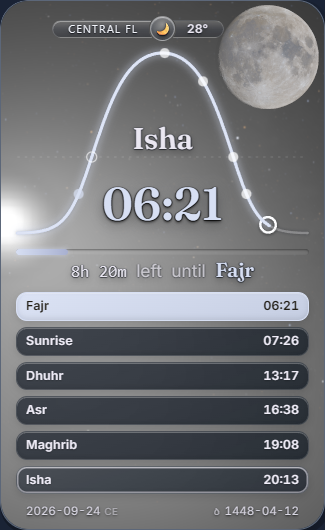
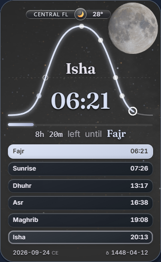
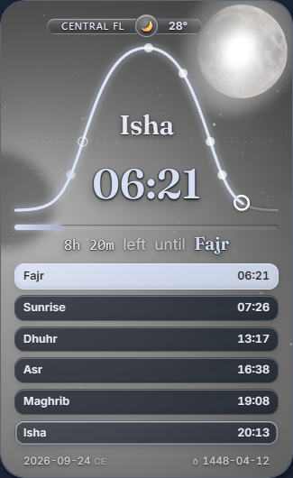

# R0022 owner display decision evidence

This non-deploying branch preserves the concrete H1/H2 comparison, ordinary H1 prototype, all retained failures, original native pixels/videos, exact buffers, source identities and independent read-only review. It does not close issue #34 or grant production merge approval.

Recommended contract: **R0022-L1-H1-K003-H020-v1**. The JSON contract and original whole cards under `decision/` describe the actual owner selection. H1 bounds lunar display energy at its physical direction while retaining raw astronomical fields and V5. H2 fails the unchanged proposed ROI bounds and puts glare over the calendar Moon.

| Current-main baseline, held arm A | Recommended H1, arm B | Rejected H2, arm C |
|---|---|---|
|  |  |  |

[Exact display contract](decision/display-contract.json) · [Independent decision review](decision/independent-review.json) · [Downloadable comparison report with original video links](decision/OWNER_DISPLAY_DECISION.html)

`payload-manifest.json` maps every original byte stream to a lossless archive. Direct image/video copies are byte-identical conveniences for review. Each archive was decoded and checked before publication. A separate Git/HTTP readback receipt follows publication. Local paths inside historical records are provenance; archive member names provide the portable mapping.

The ordinary captures are display-propagation observations, not R0021 timing or actual extension-parent qualification. Firefox held comparison r4 failed currentness before any arm and restoration failed; context closure was containment. The later independent ordinary Firefox run does not erase that failure. Original videos remain as recorded.

Original accepted BALANCE is reused under exact source compatibility, not restarted. The final selected-source native matrix, original warmed cost and added L1 cost still require proof. Issue #34 remains OPEN. The owner must accept this display contract/appearance and later approve an independently reviewed exact production PR head/base. Only then may the already-authorized delivery/certificate-first closure sequence proceed.
